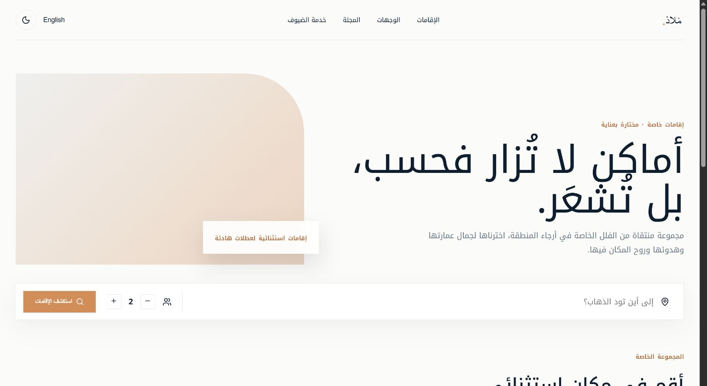

# MALATH Private Stays | مَلاذ للإقامات الخاصة

A villa discovery experience that pairs editorial imagery with practical search and booking controls. It includes image carousels, saved favorites, an illustrative interactive map, and a reservation preview that updates pricing by stay length.

[Live demo](https://eng-ayatnassar.github.io/malath-villa-booking/) · [Source code](https://github.com/eng-ayatnassar/malath-villa-booking) · [Ayat Nassar's portfolio](https://eng-ayatnassar.github.io/)



## Overview

Designed and developed by **Ayat Nassar** as a bilingual front-end portfolio project. The interface supports English and Arabic RTL, responsive layouts, and practical client-side interactions.

## Features

- Destination search, categories and guest count
- Image carousels and persistent favorites
- Interactive illustrative map pins
- Reservation pricing, Arabic/English and theme switching

## Tech stack

React · JavaScript · CSS · Vite

## Run locally

Requires **Node.js 22.12 or newer**.

```bash
npm ci
npm run dev
```

On Windows, you can also run `start.cmd`.

## Production build

```bash
npm run build
npm run preview
```

The build is written to `dist/`. Relative asset paths support deployment under a GitHub Pages repository path.

## Demo scope

**Frontend Demo.** Reservations and the map are frontend simulations. No live booking, map, or payment provider is connected. Use fictional input when trying forms. External imagery and fonts depend on their providers.

## Deployment

The GitHub Actions workflow installs locked dependencies, checks known high-severity advisories, builds, and deploys to GitHub Pages on pushes to `main`. Pull requests run the build without deployment. Repository Pages settings use **GitHub Actions** as the source.

Source, lockfiles, and preview images are tracked. `node_modules/`, `dist/`, secrets, and local logs are excluded.

## بالعربية

تجربة لاكتشاف الفلل تجمع العرض البصري مع البحث والتصفية ومعارض الصور والمفضلة، وتضم خريطة تفاعلية توضيحية ونافذة حجز تجريبية تحدّث التكلفة حسب عدد الليالي.

- بحث بالوجهة وتصنيفات وعدد الضيوف
- صور متبدّلة ومفضلة محفوظة محلياً
- دبابيس تفاعلية ضمن خريطة توضيحية
- حساب تكلفة الإقامة وتبديل اللغة والمظهر

هذا المشروع عرض Frontend لمعرض الأعمال، وليس خدمة تجارية متصلة بخادم أو نظام دفع أو حسابات حقيقية.
